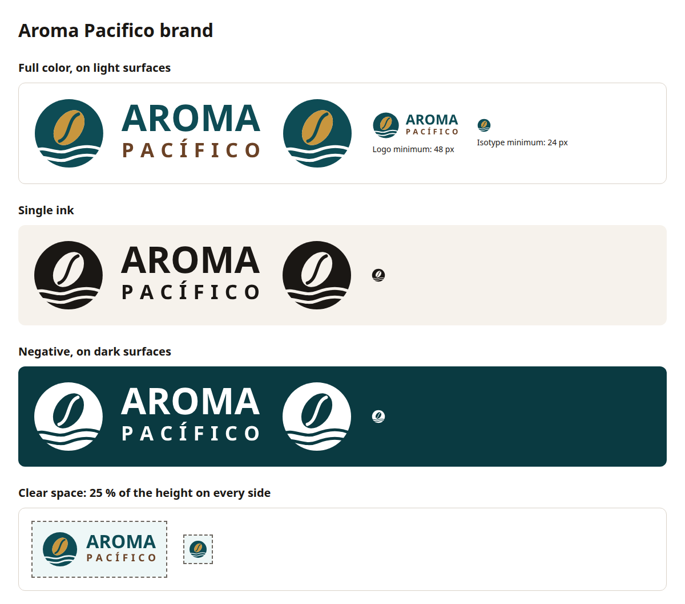

# Brand

The Aroma Pacífico brand is new for the 2026 pilot: case statement point 7 asks for a system of the three applications and rules out inheriting the 2020 manual ("No se hereda un manual de 2020"). This folder holds the logo, the isotype, and their single-ink and negative versions, as requested by point 7 ("Logo principal, isotipo y versiones en una tinta y en negativo").

## Assets

| File | Version | Use |
|---|---|---|
| [`logo.svg`](logo.svg) | Full color | Default on white, `color.neutral.50` and other light surfaces. |
| [`logo-mono.svg`](logo-mono.svg) | Single ink, `#1A1714` | One-color printing, fax-quality copies, engraving, and any surface where the full-color version cannot be reproduced. The ink may be replaced by `color.brand.primary.700` or pure black; never by a state or alert color. |
| [`logo-negative.svg`](logo-negative.svg) | Negative, white | Dark surfaces: `color.brand.primary.700`, `color.brand.primary.900`, `color.neutral.900`, and dark photographs. The file has a transparent background and looks empty on white; preview it on a dark surface. |
| [`isotype.svg`](isotype.svg) | Full color | App launcher icon, top bar of the three applications, favicon of the public lookup, avatar. |
| [`isotype-mono.svg`](isotype-mono.svg) | Single ink | As `logo-mono.svg`, when only the symbol fits. |
| [`isotype-negative.svg`](isotype-negative.svg) | Negative, white | As `logo-negative.svg`, when only the symbol fits. |

The isotype is a coffee bean over two Pacific waves inside a disc: the coffee of Cauca, Huila and Tolima on its way to Buenaventura. The bean and the waves are cut out of the disc with an SVG mask, so the single-ink and negative versions print one ink only and the background shows through the cut-outs. The full-color version fills the bean with `color.brand.parchment.400`, the color of dried parchment coffee.

All six files are plain SVG drawn on a 64-unit grid: no embedded raster, no external reference, no font. The wordmark letters are outlines converted from Noto Sans Bold, which is licensed under the SIL Open Font License 1.1 and may be used in artwork; the isotype is original geometry. [`scripts/build-brand.py`](../scripts/build-brand.py) regenerates every file from the same geometry and colors (see the root [README](../README.md#rebuilding-and-checking)).

## Clear space

The clear space is the free area around the mark that no text, edge, photograph or other graphic may enter.

| Mark | Clear space on every side | Reference |
|---|---|---|
| Logo | 25 % of the logo height | At 64 px of height, 16 px on each side. |
| Isotype | 25 % of the disc diameter | At 32 px, 8 px on each side. |

## Minimum size

| Mark | Screen | Print | Below the minimum |
|---|---|---|---|
| Logo | 48 px high | 15 mm high | Use the isotype alone. At 48 px the word PACÍFICO is still about 9 px tall. |
| Isotype | 24 px across | 8 mm across | Do not use a mark. The waves close up below 24 px. |

## Choosing a version

| Background | Version |
|---|---|
| White or a light neutral (`color.neutral.0` to `color.neutral.100`) | Full color |
| Light tint of a state or alert color | Single ink; better, move the mark off the tinted area |
| Brand dark (`color.brand.primary.700`, `color.brand.primary.900`) or `color.neutral.900` | Negative |
| Photograph | Negative on a dark, calm area; full color on a light, calm area; never on a busy area |
| One-color reproduction | Single ink |

## Where the mark does not go

The sack label and the code sheet carry only what [sack and trip](https://github.com/aroma-pacifico/aroma-pacifico-architecture/blob/main/docs/sack-and-trip.md#62-the-label-and-the-code-sheet) section 6.2 lists: the QR code, the human form of the code, the words "Consulta del saco" and the lookup host. The logo is not added to the label, so the label reveals nothing beyond the buyer view and keeps the printable area for the QR code. SMS alerts carry the text "Aroma Pacifico" and no mark.

## Misuse

| Do not | Why |
|---|---|
| Stretch, squash, rotate or skew the logo or the isotype | Changes the bean and the waves; scale proportionally only. |
| Recolor the mark with a sack state or crop alert color | Those colors mean a state or a severity in the applications; the brand must never read as a status. |
| Recolor parts of the single-ink version in different inks | It is single ink by definition. |
| Put the full-color version on a dark or saturated surface | The teal disc disappears; use the negative version. |
| Fill the cut-outs of the single-ink or negative version with white | On a colored surface the bean would turn into a white blob; the cut-outs must show the background. |
| Add shadows, outlines, gradients, glows or 3D effects | They blur in sunlight and in one-color printing. |
| Retype the wordmark in another font, change the letter spacing, or remove the accent of PACÍFICO | The wordmark is a drawn outline; use the files. |
| Rearrange the isotype and the wordmark, or set the wordmark without the isotype | The horizontal lockup is the only logo. |
| Place the mark inside the clear space of other content or below the minimum size | See the two tables above. |
| Use the mark as a sack state, a button or an alert icon | The mark identifies the pilot; icons in [`icons/`](../icons/README.md) carry meaning. |
